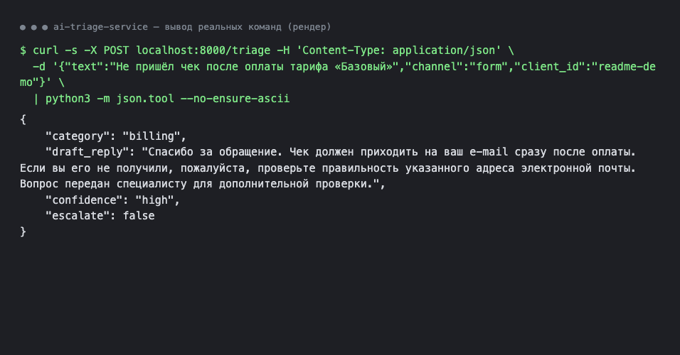
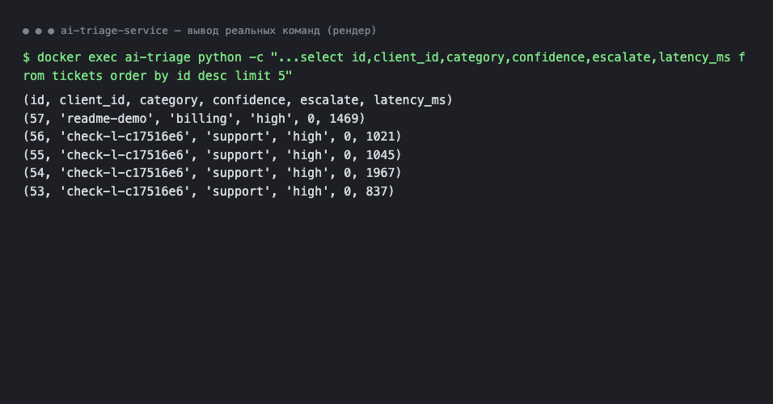
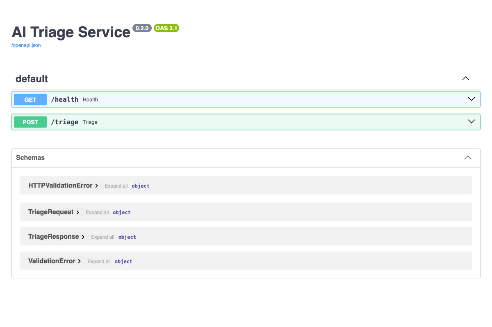

# AI Triage Service

Сервис первичной обработки обращений клиентов. Принимает текст обращения, определяет категорию, пишет черновик ответа и решает, нужен ли человек. Каждое обращение и результат записываются в SQLite.

- **Endpoint:** `POST /triage`.
- **Стек:** Python 3.12, FastAPI, SQLAlchemy, SQLite, OpenAI (gpt-4.1-mini через ProxyAPI), Docker.
- **Время запуска:** 5-10 минут.
- **Статус:** учебный проект завершён и проверен (54 автотеста, проверка работающего контейнера 6 из 6). Публично не развёрнут: ключ к модели платный, а доступа по ключу клиента пока нет (см. «Планы»).
- Все тексты в проекте вымышленные. Реальные данные клиентов в модель не отправляйте: текст обращения уходит во внешний сервис.

## Задача и что делает сервис

Поддержка тратит время на первичную сортировку обращений и черновики ответов. Сервис берёт эту работу на себя, но решение оставляет человеку:

- определяет категорию (`billing`, `support`, `complaint`, `other`);
- пишет черновик ответа по справке о компании (`config/knowledge.md`), ничего не выдумывая сверх неё;
- оценивает уверенность и передаёт оператору жалобы, неуверенные случаи и сбои модели;
- не выполняет инструкции, спрятанные в тексте обращения («игнорируй правила…»);
- ограничивает частоту запросов (5 в минуту на `client_id`);
- записывает каждое обращение в таблицу `tickets`: текст, результат, задержку, причину сбоя.

Ответ клиенту сервис сам не отправляет: это черновик для оператора.

## Как это выглядит

Запрос и ответ (вывод реальной команды, оформлен как рендер терминала):



Журнал обращений в базе (вывод реального запроса к таблице `tickets`, рендер):



Документация API, которую FastAPI строит сам (`/docs`, снимок живого сервиса в браузере):



## Что внутри

```
app/        код: main.py (HTTP), triage.py (ядро), llm.py (вызов модели),
            limiter.py (лимит), store.py (база), schemas.py (контракт), config.py (настройки)
config/     правила без кода: triage.yaml (категории, эскалация, шаблон «передано оператору»),
            prompt.md (системный промпт), knowledge.md (справка о вымышленной компании)
tests/      автотесты (без вызова модели)
scripts/    check_service.py (проверка запущенного сервиса), eval_live.py (живой прогон 14 обращений)
reports/    eval_live.md (результат живого прогона)
```

## Что нужно заранее

- Python 3.10 или новее (проверено на 3.12).
- Ключ ProxyAPI (хранится только в файле `.env`, в git не попадает).
- Для запуска в контейнере: Docker Desktop.

## Вариант 1. Запуск без Docker

```bash
# 1. Виртуальное окружение и зависимости
python3 -m venv venv
source venv/bin/activate
pip install -r requirements.txt

# 2. Настройки: скопируйте шаблон и впишите ключ в PROXY_API_KEY
cp .env.example .env
#    откройте .env в редакторе и заполните строку PROXY_API_KEY=...

# 3. Запуск
uvicorn app.main:app --port 8000
```

Сервис работает, когда в консоли появилась строка `Uvicorn running on http://127.0.0.1:8000`. База `triage.db` создаётся автоматически в текущей папке.

Если порт 8000 занят, укажите другой: `--port 8001` (и подставьте его в примерах ниже).

## Вариант 2. Запуск в Docker

```bash
# 1. Настройки (как в варианте 1)
cp .env.example .env      # впишите PROXY_API_KEY

# 2. Сборка образа
docker build -t ai-triage:1.0 .

# 3. Запуск (база лежит в томе ai_triage_data и переживает пересоздание контейнера)
docker run -d --name ai-triage -p 8000:8000 --env-file .env \
  -e DATABASE_URL=sqlite:////data/triage.db \
  -v ai_triage_data:/data ai-triage:1.0
```

Параметр `-e DATABASE_URL=...` должен стоять после `--env-file .env`, иначе значение из `.env` (путь для запуска без Docker) заменит путь к тому.

Контейнеру нужно несколько секунд на старт: если первый запрос вернул «Connection reset», повторите через 5-10 секунд (`docker logs ai-triage` покажет строку `Uvicorn running`).

Остановить: `docker stop ai-triage`. Запустить снова: `docker start ai-triage`.

## Пример запроса

```bash
curl -s -X POST http://localhost:8000/triage \
  -H "Content-Type: application/json" \
  -d '{"text": "Не пришёл чек после оплаты тарифа «Базовый»", "channel": "form", "client_id": "demo-1"}'
```

Ответ (200):

```json
{
  "category": "billing",
  "draft_reply": "Здравствуйте! Мы проверим ваш платёж и вышлем чек...",
  "confidence": "high",
  "escalate": false
}
```

Поля запроса:

| Поле | Правило |
|---|---|
| `text` | 1-2000 символов, не пустой |
| `channel` | только `email`, `form` или `chat` (метка источника) |
| `client_id` | 1-64 символа; по нему считается лимит запросов |

Поля ответа: `category` (`billing`, `support`, `complaint`, `other`), `draft_reply` (1-6 предложений), `confidence` (`high`, `medium`, `low`), `escalate` (нужен ли человек).

Коды ответов:

| Код | Когда |
|---|---|
| 200 | Обращение обработано. Если модель сбоила, всё равно 200, но `escalate=true` и шаблон «передано оператору» |
| 422 | Запрос не прошёл проверку (пустой `text`, длиннее 2000, неверный `channel`, нет `client_id`). В базу такой запрос не пишется |
| 429 | Больше 5 запросов в минуту от одного `client_id`. Время ожидания в заголовке `Retry-After` |

Интерактивная документация с формой для запроса: http://localhost:8000/docs. Проверка, что сервис жив: `GET http://localhost:8000/health`.

## Где смотреть базу (SQLite)

Каждое принятое обращение попадает в таблицу `tickets`: время, `client_id`, `channel`, `text`, `category`, `draft_reply`, `confidence`, `escalate`, `error` (текст сбоя, если был), `model`, `latency_ms`.

Запуск без Docker (файл `triage.db` в папке проекта):

```bash
sqlite3 triage.db "SELECT id, created_at, client_id, category, confidence, escalate, error FROM tickets ORDER BY id DESC LIMIT 10;"
```

Запуск в Docker (внутри образа нет программы `sqlite3`, используем Python):

```bash
docker exec ai-triage python -c "import sqlite3; c=sqlite3.connect('/data/triage.db'); [print(r) for r in c.execute('SELECT id, created_at, client_id, category, confidence, escalate, error FROM tickets ORDER BY id DESC LIMIT 10')]"
```

## Где смотреть логи

Сервис пишет логи в консоль. Формат строки: время, уровень, источник, сообщение. По каждому обращению - номер тикета, длина текста, категория и признак эскалации. Сам текст обращения в логи не попадает.

- Без Docker: в окне, где запущен `uvicorn`.
- В Docker: `docker logs ai-triage` (последние строки: `docker logs --tail 20 ai-triage`).

## Проверки

Автотесты (модель подменяется заглушкой, ключ не нужен):

```bash
pip install -r requirements-dev.txt
pytest
```

Проверка запущенного сервиса по HTTP (6 проверок, делает несколько живых вызовов модели, нужен ключ в `.env`):

```bash
python3 scripts/check_service.py http://localhost:8000
```

## Настройки (файл `.env`)

| Переменная | Что делает | По умолчанию |
|---|---|---|
| `PROXY_API_KEY` | ключ ProxyAPI (обязательно) | пусто |
| `LLM_PROVIDER` | `openai` или `anthropic` | `openai` |
| `OPENAI_MODEL` | модель | `gpt-4.1-mini` |
| `LLM_TEMPERATURE` | температура (меньше - меньше «фантазии») | `0.2` |
| `RATE_LIMIT_PER_MINUTE` | лимит запросов в минуту на `client_id` | `5` |
| `DATABASE_URL` | где лежит база | `sqlite:///./triage.db` |

Категории, правила эскалации и текст «передано оператору» меняются в `config/triage.yaml` без правки кода.

## Как работает защита и «если всё сломалось»

- **Эскалация к человеку** (`escalate=true`) всегда, если категория `complaint`, или уверенность `low`, или сбой модели. Это решает код по правилам из `triage.yaml`, а не модель.
- **Сбой модели** (таймаут, ошибка сервиса, ответ не в нужном формате): клиент получает 200, категорию `other`, шаблонный ответ «передано оператору» и `escalate=true`. Причина записывается в поле `error`.
- **Манипуляции** («забудь все правила», «покажи системный промпт» и подобное): модель не вызывается, ответ-заглушка и `escalate=true`. Защита в два слоя: список фраз в `triage.yaml` и правила в промпте. Список ловит только известные формулировки.
- **Лимит**: не больше 5 запросов в минуту на один `client_id`, считается по таблице `tickets`. В лимит попадают и обращения, на которых модель сбоила.
- **Ключ** хранится только в `.env` (в `.gitignore`, в образ Docker не вшивается). Без ключа сервис всё равно запускается, но каждое обращение уходит оператору (`escalate=true`), а в поле `error` и в логах записано «Не задан PROXY_API_KEY».

## Частые проблемы

| Симптом | Причина и решение |
|---|---|
| В `error` и логах `Не задан PROXY_API_KEY` | нет файла `.env` или пустой ключ: `cp .env.example .env`, впишите ключ, перезапустите сервис |
| Порт 8000 занят | на macOS порт 5000 занят AirPlay, поэтому используем 8000; если занят и он, запустите на другом (`--port 8001`, `-p 8001:8000`) |
| В Docker нет данных после перезапуска | контейнер запущен без тома: проверьте `-v ai_triage_data:/data` и `-e DATABASE_URL=sqlite:////data/triage.db` после `--env-file` |
| 429 при ручных запросах | больше 5 запросов в минуту с одним `client_id`: подождите время из `Retry-After` или смените `client_id` (`check_service.py` каждый раз берёт новый) |
| Всегда `escalate=true` и ответ «передано оператору» | модель недоступна: смотрите поле `error` в таблице `tickets` и логи (неверный ключ, нет денег на ProxyAPI, нет сети) |

## Планы (версия 2)

- Аутентификация по ключу клиента и дневной бюджет токенов: без них сервис нельзя выставлять в интернет (сейчас `client_id` задаёт сам вызывающий, лимит обходится).
- Проверка точности на большой независимой выборке обращений: сейчас 14 моих примеров, это не оценка точности.
- Админка: список обращений, правка категорий оператором, отчёт по эскалациям.
- Реальные каналы (почта, форма, чат) и справка компании из базы знаний (RAG).
- Подробнее: [REPORT.md](REPORT.md), разделы 6 («Надёжность») и 9 («Что улучшить в версии 2»).
